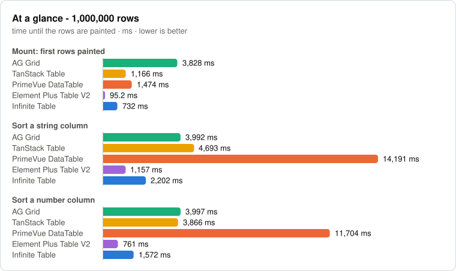
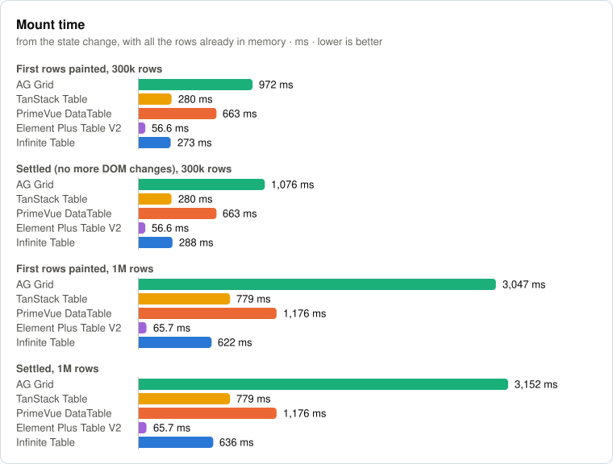
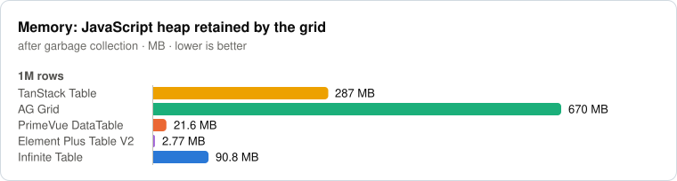
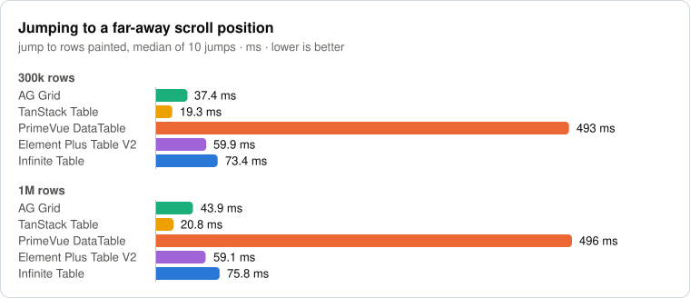
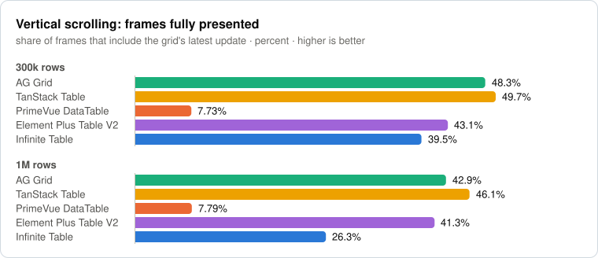
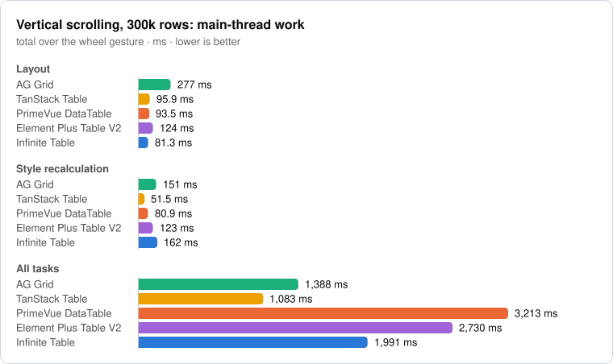
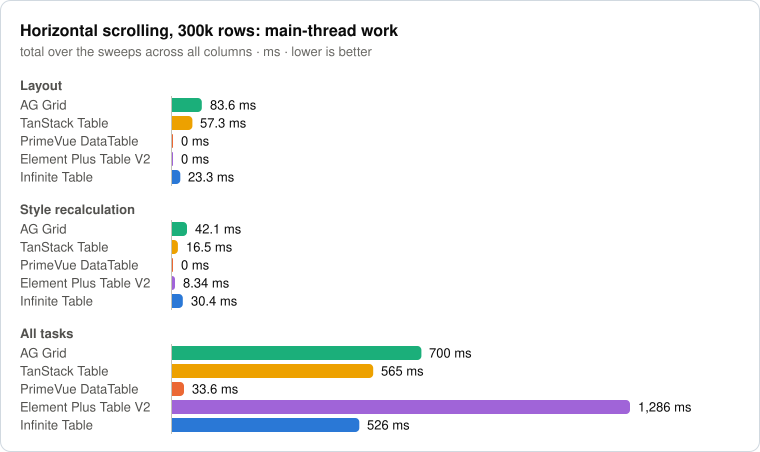

# Vue DataGrid performance comparison: TanStack Table, AG Grid, PrimeVue DataTable, Element Plus Table V2 and Infinite Table

A reproducible benchmark of five Vue 3 DataGrids at 1,000,000 rows: mount
time, memory, sorting, scrolling and live data updates - with
the rows as they are, sorted, filtered, and grouped with aggregations.

- [TanStack Table](https://tanstack.com/table), which is headless, rendered
  with [TanStack Virtual](https://tanstack.com/virtual) as in its official
  virtualization example
- [AG Grid Vue](https://www.ag-grid.com/vue-data-grid/) (Community)
- [PrimeVue DataTable](https://primevue.org/datatable/), in its virtual
  scroller mode
- [Element Plus Table V2](https://element-plus.org/en-US/component/table-v2.html),
  the virtualized table of Element Plus
- [Infinite Table for Vue](https://infinite-table.com)

All of them are installed from npm, render the same data in the same browser,
and get the same interactions. The benchmark runs again whenever a new version
of any of them is published, and the results below are updated -
or you can [run it yourself](#run-it), with any versions.

It is the Vue counterpart of the
[React DataGrid performance comparison](https://github.com/infinite-table/datagrid-performance-comparison):
the same data, scenarios, measuring code and statistics, with the Vue grids.

The five are not the same kind of thing, and they don't all do everything the
scenarios ask for. Four things to know before reading the numbers - all are
explained in [What is compared](#what-is-compared):

- **TanStack Table renders nothing by itself.** What is measured is TanStack
  Table plus TanStack Virtual plus the markup of the official example - a
  much smaller thing than a full grid, with no keyboard navigation, cell
  selection, column menus or pinned columns.
- **Element Plus Table V2 does not sort.** It shows the sort indicator and
  tells the page which header was clicked; the page sorts the array. Its
  sorting numbers are the browser's `Array.prototype.sort` plus the table
  rendering the result.
- **PrimeVue DataTable and Element Plus Table V2 don't virtualize columns.**
  Every rendered row has all the 20 cells. The TanStack page, AG Grid and
  Infinite Table render only the columns in view.
- **With 1,000,000 rows, only AG Grid and Infinite Table can scroll to the
  last row.** TanStack Table (with TanStack Virtual), PrimeVue DataTable and
  Element Plus Table V2 stop near row 838,860.

We make Infinite Table, so read this with healthy suspicion - that is why the
whole thing is here for you to run.

<!-- results:start - generated by scripts/update-results.ts, do not edit by hand -->

## Results

**TanStack Table 9.3.1** (with TanStack Virtual 3.13.52), **AG Grid Vue 36.3.0** (Community), **PrimeVue DataTable 4.5.5**, **Element Plus Table V2 2.14.8** and **Infinite Table for Vue 10.2.1** - measured on 2026-11-25, on GitHub Actions, ubuntu-24.04 (Intel(R) Xeon(R) 6975P-C × 4), in Chrome 136.0.7103.25 (headless). Every value is the median of 7 runs.

The absolute numbers depend on the machine - compare the grids, not the milliseconds. In the table under the charts, a difference is only called when the 95% confidence interval excludes "no difference".

<picture>
  <source media="(prefers-color-scheme: dark)" srcset="results/latest/charts/at-a-glance-dark.svg">
  
</picture>

<picture>
  <source media="(prefers-color-scheme: dark)" srcset="results/latest/charts/mount-dark.svg">
  
</picture>

<picture>
  <source media="(prefers-color-scheme: dark)" srcset="results/latest/charts/memory-dark.svg">
  
</picture>

<picture>
  <source media="(prefers-color-scheme: dark)" srcset="results/latest/charts/sort-1m-dark.svg">
  
</picture>

The string column is lowercase a-z text, sorted in an `en-US` browser. The grids do not compare strings the same way - see [String sorting](#string-sorting). Element Plus Table V2 does not sort: its bars are the page sorting the array and the table rendering it - see [Element Plus Table V2](#element-plus-table-v2-no-sorting-of-its-own).

<picture>
  <source media="(prefers-color-scheme: dark)" srcset="results/latest/charts/scroll-jump-dark.svg">
  
</picture>

With 1M rows, the last row that can be scrolled to is not the last row of the data in: TanStack Table (row 838,860), PrimeVue DataTable (row 838,881), Element Plus Table V2 (row 838,861). AG Grid and Infinite Table reach the last row. See [Scroll range](#scroll-range).

<picture>
  <source media="(prefers-color-scheme: dark)" srcset="results/latest/charts/scroll-frames-dark.svg">
  
</picture>

<picture>
  <source media="(prefers-color-scheme: dark)" srcset="results/latest/charts/scroll-vertical-work-dark.svg">
  
</picture>

<picture>
  <source media="(prefers-color-scheme: dark)" srcset="results/latest/charts/scroll-horizontal-work-dark.svg">
  
</picture>

<picture>
  <source media="(prefers-color-scheme: dark)" srcset="results/latest/charts/updates-low-1m-dark.svg">
  
</picture>

<picture>
  <source media="(prefers-color-scheme: dark)" srcset="results/latest/charts/updates-high-1m-dark.svg">
  
</picture>

<picture>
  <source media="(prefers-color-scheme: dark)" srcset="results/latest/charts/updates-high-fps-1m-dark.svg">
  
</picture>

<picture>
  <source media="(prefers-color-scheme: dark)" srcset="results/latest/charts/updates-high-work-1m-dark.svg">
  
</picture>

<details>
<summary>The same numbers, as a table - and how Infinite Table compares with each grid</summary>

| | TanStack Table | AG Grid | PrimeVue DataTable | Element Plus Table V2 | Infinite Table | Infinite Table vs each grid |
|---|---:|---:|---:|---:|---:|---|
| Mount - First rows painted, 1M rows | 614 ms | 2,382 ms | 891 ms | 48.6 ms | 527 ms | vs TanStack Table: **Infinite Table** 14% lower<br>vs AG Grid: **Infinite Table** 4.52× lower<br>vs PrimeVue DataTable: **Infinite Table** 41% lower<br>vs Element Plus Table V2: **Element Plus Table V2** 10.8× lower |
| Mount - Settled (no more DOM changes), 1M rows | 614 ms | 2,486 ms | 891 ms | 48.6 ms | 539 ms | vs TanStack Table: **Infinite Table** 12% lower<br>vs AG Grid: **Infinite Table** 4.61× lower<br>vs PrimeVue DataTable: **Infinite Table** 39% lower<br>vs Element Plus Table V2: **Element Plus Table V2** 11.1× lower |
| Memory - 1M rows | 287 MB | 670 MB | 21.6 MB | 2.77 MB | 90.8 MB | vs TanStack Table: **Infinite Table** 3.17× lower<br>vs AG Grid: **Infinite Table** 7.38× lower<br>vs PrimeVue DataTable: **PrimeVue DataTable** 4.2× lower<br>vs Element Plus Table V2: **Element Plus Table V2** 32.8× lower |
| Sort, 1M rows - String column, ascending | 3,833 ms | 4,140 ms | 9,962 ms | 934 ms | 1,449 ms | vs TanStack Table: **Infinite Table** 2.65× lower<br>vs AG Grid: **Infinite Table** 2.86× lower<br>vs PrimeVue DataTable: **Infinite Table** 6.88× lower<br>vs Element Plus Table V2: **Element Plus Table V2** 36% lower |
| Sort, 1M rows - String column, descending | 3,767 ms | 4,140 ms | 9,967 ms | 1,001 ms | 1,510 ms | vs TanStack Table: **Infinite Table** 2.49× lower<br>vs AG Grid: **Infinite Table** 2.74× lower<br>vs PrimeVue DataTable: **Infinite Table** 6.6× lower<br>vs Element Plus Table V2: **Element Plus Table V2** 34% lower |
| Sort, 1M rows - Number column, ascending | 3,356 ms | 4,514 ms | 8,885 ms | 626 ms | 569 ms | vs TanStack Table: **Infinite Table** 5.9× lower<br>vs AG Grid: **Infinite Table** 7.94× lower<br>vs PrimeVue DataTable: **Infinite Table** 15.6× lower<br>vs Element Plus Table V2: **Infinite Table** 9% lower |
| Sort, 1M rows - Number column, descending | 3,417 ms | 4,489 ms | 9,070 ms | 695 ms | 576 ms | vs TanStack Table: **Infinite Table** 5.93× lower<br>vs AG Grid: **Infinite Table** 7.79× lower<br>vs PrimeVue DataTable: **Infinite Table** 15.7× lower<br>vs Element Plus Table V2: **Infinite Table** 17% lower |
| Jump to rows painted - 1M rows | 13.5 ms | 26.9 ms | 262 ms | 32.6 ms | 32 ms | vs TanStack Table: **TanStack Table** 2.37× lower<br>vs AG Grid: **AG Grid** 16% lower<br>vs PrimeVue DataTable: **Infinite Table** 8.17× lower<br>vs Element Plus Table V2: **Infinite Table** 2% lower |
| Vertical scrolling, frames fully presented - 1M rows | 100% | 64.9% | 13.3% | 50% | 80.7% | vs TanStack Table: **TanStack Table** 19.3 points higher<br>vs AG Grid: **Infinite Table** 15.7 points higher<br>vs PrimeVue DataTable: **Infinite Table** 67.4 points higher<br>vs Element Plus Table V2: **Infinite Table** 30.7 points higher |
| Vertical scrolling, 1M rows, main-thread work - Layout | 69.7 ms | 363 ms | 88.6 ms | 111 ms | 69.5 ms | vs TanStack Table: no significant difference<br>vs AG Grid: **Infinite Table** 5.23× lower<br>vs PrimeVue DataTable: **Infinite Table** 22% lower<br>vs Element Plus Table V2: **Infinite Table** 37% lower |
| Vertical scrolling, 1M rows, main-thread work - Style recalculation | 35.6 ms | 114 ms | 60.5 ms | 97.4 ms | 204 ms | vs TanStack Table: **TanStack Table** 5.71× lower<br>vs AG Grid: **AG Grid** 44% lower<br>vs PrimeVue DataTable: **PrimeVue DataTable** 3.37× lower<br>vs Element Plus Table V2: **Element Plus Table V2** 2.09× lower |
| Vertical scrolling, 1M rows, main-thread work - All tasks | 798 ms | 1,490 ms | 3,186 ms | 2,088 ms | 1,624 ms | vs TanStack Table: **TanStack Table** 2.04× lower<br>vs AG Grid: **AG Grid** 8% lower<br>vs PrimeVue DataTable: **Infinite Table** 49% lower<br>vs Element Plus Table V2: **Infinite Table** 22% lower |
| Horizontal scrolling, 1M rows, main-thread work - Layout | 40 ms | 56.2 ms | 0 ms | 0 ms | 19.1 ms | vs TanStack Table: **Infinite Table** 2.1× lower<br>vs AG Grid: **Infinite Table** 2.94× lower<br>vs PrimeVue DataTable: **PrimeVue DataTable** 100% lower<br>vs Element Plus Table V2: **Element Plus Table V2** 100% lower |
| Horizontal scrolling, 1M rows, main-thread work - Style recalculation | 12 ms | 30.2 ms | 0 ms | 6.19 ms | 25.1 ms | vs TanStack Table: **TanStack Table** 2.08× lower<br>vs AG Grid: **Infinite Table** 17% lower<br>vs PrimeVue DataTable: **PrimeVue DataTable** 100% lower<br>vs Element Plus Table V2: **Element Plus Table V2** 4.05× lower |
| Horizontal scrolling, 1M rows, main-thread work - All tasks | 335 ms | 381 ms | 29.2 ms | 887 ms | 402 ms | vs TanStack Table: **TanStack Table** 17% lower<br>vs AG Grid: **AG Grid** 5% lower<br>vs PrimeVue DataTable: **PrimeVue DataTable** 13.8× lower<br>vs Element Plus Table V2: **Infinite Table** 2.2× lower |
| Live updates, 1M rows - Rows as they are | 463 ms | 124 ms | 684 ms | 18.1 ms | 366 ms | vs TanStack Table: **Infinite Table** 21% lower<br>vs AG Grid: **AG Grid** 2.96× lower<br>vs PrimeVue DataTable: **Infinite Table** 47% lower<br>vs Element Plus Table V2: **Element Plus Table V2** 20.2× lower |
| Live updates, 1M rows - Sorted by the salary, which the updates change | 4,077 ms | 5,611 ms | 8,962 ms | 671 ms | 536 ms | vs TanStack Table: **Infinite Table** 7.6× lower<br>vs AG Grid: **Infinite Table** 10.5× lower<br>vs PrimeVue DataTable: **Infinite Table** 16.7× lower<br>vs Element Plus Table V2: **Infinite Table** 20% lower |
| Live updates, 1M rows - Filtered on the salary | 1,472 ms | 280 ms | 568 ms | 46.2 ms | 310 ms | vs TanStack Table: **Infinite Table** 4.74× lower<br>vs AG Grid: **AG Grid** 10% lower<br>vs PrimeVue DataTable: **Infinite Table** 45% lower<br>vs Element Plus Table V2: **Element Plus Table V2** 6.72× lower |
| Live updates, 1M rows - Grouped by department, salaries summed | 1,850 ms | – | – | – | 813 ms | vs TanStack Table: **Infinite Table** 2.27× lower |
| A feed of 50 updates a second, 1M rows, lag at the end - Rows as they are | 699 ms | 174 ms | 1,175 ms | 27.6 ms | 558 ms | vs TanStack Table: no significant difference<br>vs AG Grid: **AG Grid** 3.2× lower<br>vs PrimeVue DataTable: **Infinite Table** 2.1× lower<br>vs Element Plus Table V2: **Element Plus Table V2** 20.2× lower |
| A feed of 50 updates a second, 1M rows, lag at the end - Sorted by the salary, which the updates change | 5,262 ms | 7,669 ms | 15,156 ms | 1,228 ms | 984 ms | vs TanStack Table: **Infinite Table** 5.35× lower<br>vs AG Grid: **Infinite Table** 7.8× lower<br>vs PrimeVue DataTable: **Infinite Table** 15.4× lower<br>vs Element Plus Table V2: **Infinite Table** 20% lower |
| A feed of 50 updates a second, 1M rows, lag at the end - Filtered on the salary | 1,224 ms | 430 ms | 774 ms | 56.5 ms | 422 ms | vs TanStack Table: **Infinite Table** 2.9× lower<br>vs AG Grid: no significant difference<br>vs PrimeVue DataTable: **Infinite Table** 46% lower<br>vs Element Plus Table V2: **Element Plus Table V2** 7.46× lower |
| A feed of 50 updates a second, 1M rows, lag at the end - Grouped by department, salaries summed | 2,063 ms | – | – | – | 1,789 ms | vs TanStack Table: **Infinite Table** 13% lower |
| A feed of 50 updates a second, 1M rows, frame rate - Rows as they are | 1.71 fps | 7.54 fps | 1.16 fps | 57.1 fps | 2.4 fps | vs TanStack Table: **Infinite Table** 41% higher<br>vs AG Grid: **AG Grid** 3.14× higher<br>vs PrimeVue DataTable: **Infinite Table** 2.06× higher<br>vs Element Plus Table V2: **Element Plus Table V2** 23.8× higher |
| A feed of 50 updates a second, 1M rows, frame rate - Sorted by the salary, which the updates change | 0.12 fps | 0.09 fps | 0.05 fps | 1.15 fps | 1.61 fps | vs TanStack Table: **Infinite Table** 13.3× higher<br>vs AG Grid: **Infinite Table** 18.8× higher<br>vs PrimeVue DataTable: **Infinite Table** 30.8× higher<br>vs Element Plus Table V2: **Infinite Table** 40% higher |
| A feed of 50 updates a second, 1M rows, frame rate - Filtered on the salary | 0.58 fps | 3.37 fps | 1.47 fps | 23.8 fps | 3.12 fps | vs TanStack Table: **Infinite Table** 5.41× higher<br>vs AG Grid: no significant difference<br>vs PrimeVue DataTable: **Infinite Table** 2.12× higher<br>vs Element Plus Table V2: **Element Plus Table V2** 7.61× higher |
| A feed of 50 updates a second, 1M rows, frame rate - Grouped by department, salaries summed | 0.33 fps | – | – | – | 1.04 fps | vs TanStack Table: **Infinite Table** 3.13× higher |
| A feed of 50 updates a second, 1M rows, main-thread work - Rows as they are | 4,680 ms | 4,155 ms | 5,156 ms | 2,663 ms | 4,539 ms | vs TanStack Table: no significant difference<br>vs AG Grid: **AG Grid** 8% lower<br>vs PrimeVue DataTable: **Infinite Table** 12% lower<br>vs Element Plus Table V2: **Element Plus Table V2** 41% lower |
| A feed of 50 updates a second, 1M rows, main-thread work - Sorted by the salary, which the updates change | 9,243 ms | 11,652 ms | 19,161 ms | 5,209 ms | 4,968 ms | vs TanStack Table: **Infinite Table** 46% lower<br>vs AG Grid: **Infinite Table** 2.35× lower<br>vs PrimeVue DataTable: **Infinite Table** 3.86× lower<br>vs Element Plus Table V2: **Infinite Table** 5% lower |
| A feed of 50 updates a second, 1M rows, main-thread work - Filtered on the salary | 5,206 ms | 4,411 ms | 4,755 ms | 4,030 ms | 4,403 ms | vs TanStack Table: **Infinite Table** 15% lower<br>vs AG Grid: no significant difference<br>vs PrimeVue DataTable: **Infinite Table** 7% lower<br>vs Element Plus Table V2: **Element Plus Table V2** 8% lower |
| A feed of 50 updates a second, 1M rows, main-thread work - Grouped by department, salaries summed | 6,044 ms | – | – | – | 5,780 ms | vs TanStack Table: **Infinite Table** 4% lower |

</details>

Every metric of every scenario, with standard deviations and confidence intervals: [full report](./results/latest/report.md) · [raw samples](./results/latest/results.json).

## History

Every set of versions measured so far, newest first, with a row for each grid. All the values are times in ms, except memory, in MB - lower is better. Runs measured on different machines can't be compared in absolute terms (hosted runners don't all have the same CPU) - compare how the grids relate within a run. The branch of a run has the code, the lockfile and the full results of that run.

| Run | Grid | Mount 1M | Sort string 1M | Sort number 1M | Memory 1M | Vertical scroll work 1M | Horizontal scroll work 1M | Update sorted 1M | Feed lag sorted 1M |
|---|---|---:|---:|---:|---:|---:|---:|---:|---:|
| 2026-11-25<br>GitHub Actions, ubuntu-24.04 · Intel(R) Xeon(R) 6975P-C × 4<br>[branch](https://github.com/infinite-table/vue-datagrid-performance-comparison/tree/versions/ag-grid-36.3.0_tanstack-9.3.1_primevue-4.5.5_element-plus-2.14.8_infinite-10.2.1) | TanStack Table 9.3.1 | 614 | 3,833 | 3,356 | 287 | 798 | 335 | 4,077 | 5,262 |
|  | AG Grid 36.3.0 | 2,382 | 4,140 | 4,514 | 670 | 1,490 | 381 | 5,611 | 7,669 |
|  | PrimeVue DataTable 4.5.5 | 891 | 9,962 | 8,885 | 21.6 | 3,186 | 29.2 | 8,962 | 15,156 |
|  | Element Plus Table V2 2.14.8 | 48.6 | 934 | 626 | 2.77 | 2,088 | 887 | 671 | 1,228 |
|  | Infinite Table 10.2.1 | 527 | 1,449 | 569 | 90.8 | 1,624 | 402 | 536 | 984 |
| 2026-11-17<br>GitHub Actions, ubuntu-24.04 · AMD EPYC 9V45 96-Core Processor × 4<br>[branch](https://github.com/infinite-table/vue-datagrid-performance-comparison/tree/versions/ag-grid-36.3.0_tanstack-9.3.1_primevue-4.5.5_element-plus-2.14.8_infinite-10.2.0) | TanStack Table 9.3.1 | 512 | 3,520 | 3,446 | 287 | 860 | 357 | – | – |
|  | AG Grid 36.3.0 | 2,221 | 4,250 | 4,171 | 670 | 1,589 | 465 | – | – |
|  | PrimeVue DataTable 4.5.5 | 731 | 8,643 | 8,133 | 21.7 | 3,086 | 36.3 | – | – |
|  | Element Plus Table V2 2.14.8 | 41.5 | 920 | 653 | 2.77 | 2,124 | 1,019 | – | – |
|  | Infinite Table 10.2.0 | 488 | 1,540 | 1,339 | 90.8 | 1,781 | 440 | – | – |
| 2026-11-17<br>GitHub Actions, ubuntu-24.04 · AMD EPYC 9V74 80-Core Processor × 2<br>[branch](https://github.com/infinite-table/vue-datagrid-performance-comparison/tree/versions/ag-grid-36.3.0_tanstack-9.3.1_primevue-5.0.5_element-plus-2.14.8_infinite-10.1.5) | TanStack Table 9.3.1 | 936 | 4,292 | 3,487 | 287 | 1,310 | 437 | – | – |
|  | AG Grid 36.3.0 | 3,147 | 3,950 | 3,866 | 670 | 1,941 | 496 | – | – |
|  | PrimeVue DataTable 5.0.5 | 610 | 10,592 | 8,536 | 22 | 3,464 | 32.6 | – | – |
|  | Element Plus Table V2 2.14.8 | 74 | 1,003 | 649 | 2.77 | 2,733 | 1,358 | – | – |
|  | Infinite Table 10.1.5 | 614 | 1,894 | 1,427 | 90.7 | 2,406 | 674 | – | – |
| 2026-11-17<br>GitHub Actions, ubuntu-24.04 · AMD EPYC 7763 64-Core Processor × 2<br>[branch](https://github.com/infinite-table/vue-datagrid-performance-comparison/tree/versions/ag-grid-36.3.0_tanstack-9.3.1_primevue-4.5.5_element-plus-2.14.8_infinite-10.1.5) | TanStack Table 9.3.1 | 1,166 | 4,693 | 3,866 | 287 | 1,556 | 536 | – | – |
|  | AG Grid 36.3.0 | 3,828 | 3,992 | 3,997 | 670 | 2,359 | 602 | – | – |
|  | PrimeVue DataTable 4.5.5 | 1,474 | 14,191 | 11,704 | 21.6 | 3,618 | 30 | – | – |
|  | Element Plus Table V2 2.14.8 | 95.2 | 1,157 | 761 | 2.77 | 3,029 | 1,779 | – | – |
|  | Infinite Table 10.1.5 | 732 | 2,202 | 1,572 | 90.7 | 2,622 | 825 | – | – |

<!-- results:end -->

## Run it

You need git and Node.js 20.19 or newer (we used 22). It runs on macOS and
Linux. Playwright downloads its own Chromium, so it doesn't matter which
browser you have installed.

```sh
git clone https://github.com/infinite-table/vue-datagrid-performance-comparison.git
cd vue-datagrid-performance-comparison
npm install
npx playwright install chromium

# production build, then every scenario at 1M rows
BENCH_HEADLESS=1 npm run benchmark
```

A full run is 17 scenarios × 5 grids × 8 runs at 1M rows (the 2 grouped ones
with 2 grids): about two and a quarter hours on a GitHub-hosted runner.
`BENCH_SIZES=300k,1m` adds a 300,000 rows dataset, for about another hour
and ten minutes. Without `BENCH_HEADLESS=1` it opens real browser windows - closer to
what users see, but you have to leave the machine alone while they come and
go.

For numbers you can trust, close other apps, keep a laptop plugged in, and
don't use the machine during the run.

To try it first, this takes a few minutes:

```sh
npm run benchmark:build
# mount and string sorting, 300k rows only, 3 runs per grid
BENCH_HEADLESS=1 BENCH_SIZES=300k BENCH_SCENARIOS=mount,sort-string BENCH_RUNS=3 npm run benchmark:run
```

`npm run benchmark:run` reuses the last build. Build again after you change
the code or the installed versions.

### Results

Every run writes two files to `benchmark-results/<run id>/`:

- `report.md` - one table per scenario, with the median and standard deviation
  of each grid and, for Infinite Table against each of the others, the ratio,
  its 95% confidence interval, and which grid is better when the difference is
  significant
- `results.json` - every raw sample of every run

The most recent report is also copied to `benchmark-results/latest.md`.
`benchmark-results/` is git-ignored.

## Compare other versions

The versions that are measured are the ones installed in `node_modules`. The
report records them.

```sh
npm install @tanstack/vue-table@<version> @tanstack/vue-virtual@<version>
npm install ag-grid-community@<version> ag-grid-vue3@<version>
# PrimeVue 4 goes with @primeuix/themes 2, PrimeVue 5 with @primeuix/themes 3
npm install primevue@<version> @primeuix/themes@<version>
npm install element-plus@<version>
npm install @infinite-table/infinite-vue@<version>

BENCH_HEADLESS=1 npm run benchmark
```

Keep `ag-grid-community` and `ag-grid-vue3` on the same version.

To measure only some of the grids, name them: `BENCH_GRIDS=tanstack,infinite`
(`tanstack`, `ag-grid`, `primevue`, `element-plus`, `infinite`).

## How the results above are kept up to date

The [Benchmark workflow](./.github/workflows/benchmark.yml) runs on GitHub
Actions:

- every 6 hours it looks on npm for a new version of
  `@tanstack/vue-table`, `ag-grid-vue3`, `primevue` (4.x only), `element-plus` or
  `@infinite-table/infinite-vue`. When there is one, it installs it, runs the
  whole benchmark and commits the results
- it can also be started by hand, for any versions of the five: Actions >
  Benchmark > Run workflow
- a `repository_dispatch` event of type `new-version` starts it right away,
  for a release pipeline that doesn't want to wait for the schedule

Where the results go:

- **`master`** always has the newest versions: `package.json`,
  [`results/latest`](./results/latest) (the report and the raw samples) and
  the charts above
- **a branch for every set of versions** that was measured -
  `versions/ag-grid-<version>_tanstack-<version>_primevue-<version>_element-plus-<version>_infinite-<version>` -
  with the code, the lockfile and the full results of that run
- **the [history](#history) table** on `master` has the rows of every one of
  them, from [`results/history.json`](./results/history.json)

The hosted runners are shared virtual machines without a GPU, and their CPU
can change from one run to the next (the history table says which one it was).
So the absolute numbers differ between runs. What the benchmark is after is
how the grids relate - every run goes through all of them in turn, so they
get the same conditions.

If a run fails, the workflow opens an issue and stops trying those versions
until the issue is closed.

To update the README from a run on your machine:
`node scripts/update-results.ts <run id>`.

## Look at the grids

The pages the benchmark measures are ordinary pages you can open and scroll:

```sh
npm run benchmark:build
npm run benchmark:serve     # or: npm run dev
```

Then open [localhost:4173](http://localhost:4173) (`npm run dev`:
[localhost:5173](http://localhost:5173)) for the list - a page for each grid
and size: `/benchmark/<grid>-<size>`, where the grid is `tanstack`, `ag-grid`,
`primevue`, `element-plus` or `infinite` and the size is `300k` or `1m`. If
the port is taken, pick another one with
`npm run benchmark:serve -- --port 4000`.

## What is compared

Each grid is on its defaults. Only what makes the layouts identical is set:

- **Data:** 1,000,000 rows × 20 columns, generated deterministically
  ([`data.ts`](./src/benchmark/data.ts)). Every grid imports the same module,
  and the setup checks a checksum and that all the grids show the same text in
  the visible cells. Until November 2026 every run also measured 300,000 rows:
  the grids ranked the same in most results, and scrolling does not depend on
  the row count, so the runs now measure 1M only - `BENCH_SIZES=300k,1m` adds
  300k to a run.
- **The rows are plain objects.** The page keeps the array in a `shallowRef`
  and gives every grid the same, non-reactive array - a `ref` would have Vue
  wrap each of the rows in a reactive proxy, in every grid.
- **Same row height, header height and column widths**: 40px, 40px and 150px.
- **All the rows in one scrollable view.**
- **Each page loads only its own grid** - its code and its stylesheet.
- **The same body height.** The setup measures the scrolling body of every
  grid and makes the boxes of the shorter ones taller until they match (to
  within a pixel), so all of them render the same number of rows. The grids
  differ by the few pixels of their borders; the report says by how much.

What is set for each grid, and why:

- **TanStack Table:** see below, and
  [`TanStackGrid.vue`](./src/benchmark/TanStackGrid.vue).
- **AG Grid:** the Quartz theme, all Community modules, `animateRows: false`
  (the other grids don't animate rows on sort, and the animation would make
  "sorted rows visible" ambiguous) and a `getRowId` (the other grids have a
  row id too). The rows are given through the `rowData` prop, as in its
  documentation; `ag-grid-vue3` then makes its own copy of rows that are plain
  objects, to detach them from Vue's reactivity - that copy is part of its
  mount time and of its memory. See
  [`AgGridBenchmark.vue`](./src/benchmark/AgGridBenchmark.vue).
- **PrimeVue DataTable:** see below, and
  [`PrimeVueGrid.vue`](./src/benchmark/PrimeVueGrid.vue).
- **Element Plus Table V2:** see below, and
  [`ElementPlusGrid.vue`](./src/benchmark/ElementPlusGrid.vue).
- **Infinite Table:** nothing else. See
  [`InfiniteBenchmark.vue`](./src/benchmark/InfiniteBenchmark.vue).

### TanStack Table: a headless library and our markup

TanStack Table has the row model and the sorting, and renders nothing. What
the benchmark measures is the combination its documentation recommends for
large tables: TanStack Table, [TanStack Virtual](https://tanstack.com/virtual)
for the rows and the columns, and plain `<table>` markup. The page follows the
official Vue
[virtualized-columns example](https://github.com/TanStack/table/tree/main/examples/vue/virtualized-columns),
with the same overscan (5 rows, 3 columns). What we changed:

- a fixed row height, so nothing is measured while scrolling (the example
  measures every row, for dynamic heights)
- no column resizing, and no column visibility feature
- `sortDescFirst: false` - by default the first click on a number column
  sorts descending; in the other grids it sorts ascending
- `data-row-index` and `data-column-id` attributes on the cells, for the
  measuring code

Keep in mind what is being compared when you read its numbers. This page has
no keyboard navigation, focus handling, selection, column menus, resizing,
reordering or pinning, and renders fewer DOM elements than any of the others -
which is the point of a headless library, and it is also less work on every
frame.

### PrimeVue DataTable: the virtual scroller mode

`DataTable` renders every row unless its virtual scroller is turned on. The
page follows the "Virtual Scroll" example of its
[documentation](https://primevue.org/datatable/):

- `scrollable`, `scrollHeight="flex"` and
  `virtualScrollerOptions: { itemSize: 40 }` - the item size is the row height
- the Aura theme preset (`@primeuix/themes`), the one its documentation starts
  with
- the table has `table-layout: fixed` and the width of all the columns, and
  the cells have a height of 40px and no vertical padding, so a row is exactly
  40px high

**It does not virtualize columns.** Its documentation says the virtual
scroller of `DataTable` supports the vertical orientation only, and every
rendered row has all the 20 cells.

**The benchmark measures PrimeVue 4**, the last MIT-licensed major version.
PrimeVue 5 asks for a license key - see [License keys](#license-keys).

### Element Plus Table V2: no sorting of its own

Table V2 is the virtualized table of Element Plus. It is a smaller component
than a grid: it has fixed columns, custom cell renderers and expandable rows,
and leaves the rest to the page. What is set, and what the page does:

- `fixed`, so the columns keep their widths and the table scrolls
  horizontally (by default the columns shrink to fit the width)
- `width` and `height` in px, which it requires
- **sorting is done by the page.** Table V2 draws the sort indicator and emits
  `column-sort` when a sortable header is clicked; it does not reorder the
  rows. As in the "Sortable" example of its
  [documentation](https://element-plus.org/en-US/component/table-v2.html), the
  page keeps the sort state and gives the table a sorted copy of the array:
  `Array.prototype.sort` with a comparator that uses `<` and `>` on the values
  of the column. So for this table the sorting scenarios measure the browser's
  sort and the table rendering the new array - not a sorting implementation
  of the table, which the other four have (TanStack Table's is in its row
  model).
- a `data-row-index` attribute on the rows (`row-props`), for the measuring
  code

**It does not virtualize columns** either: every rendered row has all the 20
cells.

**It scrolls on the main thread.** Its body has `overflow: hidden`: the table
listens to the wheel events, sets the scroll position itself and draws its own
scrollbars. The other four scroll a native scroll container, which the
browser's compositor can move before the grid has rendered the new rows. Keep
it in mind for the "frames fully presented" metric: a frame presented without
the main thread's update shows the content scrolled (maybe with rows missing)
in the other four, and shows no movement in a table that scrolls itself. The
correctness and screencast scenarios say what is on screen during a scroll.

### Scroll range

Browsers cap the size of an element (about 33.5M px in Chrome), and 1,000,000
rows × 40px is 40M px. A grid has to map its scrollbar onto the rows to show
all of them.

- **AG Grid and Infinite Table** do, and reach the last row.
- **TanStack Virtual, PrimeVue DataTable and Element Plus Table V2** don't:
  the element is cut at the browser's limit, and the last row that can be
  scrolled to is near row 838,860. The rows after it - about 161,000 - are
  loaded and sorted, and can't be seen. Their 1M scrolling results are for the
  part that can be reached; and because their scrollbar is not stretched, the
  same wheel gesture goes over about 20% fewer rows than in the other two
  grids.

The report has these numbers for every run, under each size.

### Scenarios

| Id                       |                                                                                            |
| ------------------------ | ------------------------------------------------------------------------------------------ |
| `mount`                  | mount the grid with all rows in memory: time to first rows painted, to settled, heap, DOM  |
| `sort-string`            | click a string column header - ascending (cold), then descending                           |
| `sort-number`            | the same, for a number column                                                              |
| `scroll-jump`            | ten programmatic jumps to far-away scroll positions                                        |
| `scroll-vertical`        | a wheel gesture down: frame rate, frame outcomes, main-thread work                         |
| `scroll-horizontal`      | wheel sweeps across all the columns                                                        |
| `correctness-vertical`   | during a very fast vertical scroll: is every cell there, and is it the right one?          |
| `correctness-horizontal` | the same, horizontally                                                                     |
| `visual-blank-vertical`  | a screencast of a very fast scroll: how many blank rows does the compositor actually show? |
| `updates-low`            | live updates, one at a time: update to rows painted                                        |
| `updates-low-sorted`     | the same, with the rows sorted by the column that changes                                  |
| `updates-low-filtered`   | the same, with the rows filtered on the column that changes                                |
| `updates-low-grouped`    | the same, with the rows grouped and the changing column summed (TanStack, Infinite)        |
| `updates-high`           | a feed of 50 updates a second: lag at the end, update delay, frame rate, main-thread work  |
| `updates-high-sorted`    | the same, sorted                                                                           |
| `updates-high-filtered`  | the same, filtered                                                                         |
| `updates-high-grouped`   | the same, grouped (TanStack, Infinite)                                                     |

Every grid runs every scenario at both sizes, except the grouped ones - see
[Live updates](#live-updates).

### Live updates

Rows change while the grid shows them - like prices in a trading blotter.
An update changes four number fields (`salary`, `bonus`, `hours`, `score`, by
up to ±1%) in new copies of some rows: random rows, plus all the rows in the
viewport, so that every update changes what is on screen. Every grid gets the
same updates ([`updates.ts`](./src/benchmark/updates.ts)), worked out before
anything is measured, and each one is checked on screen: the right rows, with
the new values, in the right order.

The grid shows the rows in one of four views, set when it mounts:

- **as they are** - in the order of the data
- **sorted** by the salary, highest first - the updates change the salaries,
  so rows move
- **filtered** to a salary of at least 115,000, about half of the rows - rows
  go in and out of the filter
- **grouped** by department (10 collapsed groups), with the sum of the
  salaries of each group in the salary column - the sums change. Only
  TanStack Table and Infinite Table are measured here: AG Grid has row
  grouping and aggregation in Enterprise, PrimeVue DataTable groups rows for
  display but leaves the aggregations to the page, and Element Plus Table V2
  has no grouping.

and the updates come in one of two ways:

- **low frequency** (`updates-low-*`): 10 updates of 1,000 random rows each,
  one at a time - each one 500 ms after the previous one is painted. Measured
  from sending the update to the first frame that shows it.
- **high frequency** (`updates-high-*`): a feed of 50 updates a second, of
  100 random rows each, for 4 seconds. The page hands the grid the updates
  once per animation frame - all those that arrived since the previous frame,
  as one update, the way an app buffers the messages of a socket. A grid that
  keeps the main thread busy gets them later, and more at once. Measured: the
  lag at the end (from the last update to the frame that shows it), how late
  the updates get to the grid, and the main-thread work. The frame rate, the
  gaps between frames and the blocking time come from the trace (the frames
  the main thread committed, and the part over 50 ms of every task), not from
  the page: a main thread blocked for seconds gets few rAF callbacks or Long
  Animation Frame entries to measure with.

Each grid gets the rows the way it documents for changing them:

- **TanStack Table:** a new `data` array (in a `shallowRef`). The filtered
  view adds its column filtering feature, and the grouped view its grouping
  and aggregation features (only the salary is aggregated, as in the other
  grid); the other views keep the features of the other scenarios. There is
  no row expanding, so the groups stay collapsed.
- **AG Grid:** `api.applyTransaction({ update: rows })`. The views are its
  `initialState` sort and filter models, with the number filter on the salary
  column.
- **PrimeVue DataTable:** a new `value` array. The views are its `sortField`
  / `sortOrder` and `filters` props (with no filter UI in the header).
- **Element Plus Table V2:** a new `data` array. It does not sort or filter,
  so in the sorted and filtered views the page sorts and filters the rows -
  again on every update, as it does when a header is clicked.
- **Infinite Table:** `dataSourceApi.updateDataArray(rows)`. The views are
  `defaultSortInfo`, `defaultFilterValue` (with `showColumnFilters: false`,
  so the header stays as high as in the other grids), and `groupBy` with an
  `aggregationReducers` sum and collapsed groups.

For the grids that take a new array, making it (a copy of the million rows,
with the changed ones in it) is part of what is measured - it is what an app
does with them.

### String sorting

The string column is lowercase a-z text, and the browser runs as `en-US`. The
five don't compare strings the same way by default:

- **TanStack Table** picks its `text` sorting for this column: it compares the
  lowercased values by character code.
- **AG Grid** compares character codes (`<`), which puts "Zebra" before
  "apple".
- **PrimeVue DataTable** uses the order of the browser's locale (an
  `Intl.Collator`, with the `numeric` option).
- **Element Plus Table V2** does not sort - the page compares character codes
  (`<`), see above.
- **Infinite Table** uses the order of the browser's locale
  (`localeCompare`).

For lowercase a-z all five give the same order, which the benchmark checks.

Sorting a number column doesn't depend on any of this.

## License keys

TanStack Table, AG Grid Community and Element Plus need no license key, and
Infinite Table for Vue shows nothing different without one.

PrimeVue is measured at its newest 4.x version (the `v4-stable` tag on npm),
which is MIT-licensed and needs no key. PrimeVue 5 is distributed under the
PrimeUI license, which asks for a license key (there is a free Community
license for those who qualify - see its
[licenses](https://primeui.dev/licenses)). Without a key, PrimeVue 5 logs
"PrimeUI license is not configured" and shows an "Invalid PrimeUI License"
badge in the bottom-right corner of the page, so the benchmark doesn't use it.

To measure PrimeVue 5 with your own key, install `primevue@5` and
`@primeuix/themes@3`, set the key as the PrimeVue documentation says, in
[`primevue.ts`](./src/benchmark/primevue.ts), and build again. The scheduled
runs only look for new 4.x versions.

## Methodology

- **Production builds only.** The spec refuses a development build
  (`BENCH_ALLOW_DEV=1` to try it against `npm run dev` anyway).
- **Fresh browser context per run**, interleaved: every scenario runs
  `BENCH_WARMUP` + `BENCH_RUNS` times per grid, going through all the grids
  in each run and changing their order from one run to the next; warmup runs
  are discarded.
- **Latency from traces**, as in
  [js-framework-benchmark](https://github.com/krausest/js-framework-benchmark):
  from the input (pointerdown, the state change that mounts the grid, setting
  `scrollTop`) to the end of the first `Commit` after the DOM shows the
  expected content.
  - _visible_ - the first and last visible rows/columns show the right
    content, at the right place
  - _settled_ - the first frame committed after the grid's last DOM mutation.
    We don't use js-framework-benchmark's "last rAF/timer" rule, because grids
    schedule debounce timers that do no visible work.
- **Scrolling uses real input**: `Input.synthesizeScrollGesture` (Chrome's
  input pipeline, threaded scrolling), the same gesture for every grid.
  - frame outcomes from the compositor's `PipelineReporter` trace events:
    presented with the main-thread update, presented without it ("partial" -
    the compositor scrolled what it had), or dropped
  - rAF intervals and Long Animation Frames from the page
- **Correctness probe** (`correctness-*`): after every frame, samples points
  across the body and checks that the cell there is the one that should be
  there for the current scroll position - "blank" (no cell) or "wrong"
  (another row's content, or a cell lagging the scroll). It reads layout, so
  it runs in its own pass, never together with timing.
- **Screencast** (`visual-blank-vertical`): records what the compositor
  actually displays during a fast scroll and counts blank rows - this also
  catches the compositor scrolling ahead of the main thread.
- **Scroll range** (setup): browsers cap element sizes, and 1M rows × 40px is
  more than that. The setup scrolls each grid to the middle and to the end, to
  report whether the last row is reachable and how the scrollbar maps onto the
  rows. The probes and jumps use that mapping, so they measure rendering - not
  mapping differences. See [Scroll range](#scroll-range).
- **Sandboxed Chromium**: the benchmark turns Chromium's sandbox on
  (Playwright turns it off by default), as in real Chrome. Without it, on
  macOS, the first hover recompute after a layout change under the mouse
  blocks the main thread for 30-80ms, once per page. It showed up as one long
  frame at the start of the first scroll - only for the grid that updates rows
  under the mouse first - and does not happen in a sandboxed renderer.
- **Fixed display scale**: Chromium runs with `--force-device-scale-factor=1`.
  The largest element a page can have depends on the scale factor of the
  display the window is on (about 33.5M px at 1x, 16.7M px at 2x), whatever
  the emulated `deviceScaleFactor`. Pinning it gives every grid the same limit
  on every machine; the setup fails if the grids that reach their last row
  don't map the scrollbar the same way.
- **Main-thread work**: from Chrome's `Performance.getMetrics` - layout,
  style recalculation, and all tasks. The React benchmark also reports
  "scripting" (`ScriptDuration`); this one doesn't, because that metric does
  not count the JavaScript that runs in microtasks, and Vue renders in a
  microtask. A grid that renders through Vue would show almost no scripting,
  and one that renders in its own event handlers would show all of it. "All
  tasks" includes the scripting of every grid.
- **Statistics**: medians. Infinite Table is compared with each of the other
  grids: a 95% bootstrap confidence interval of the ratio of medians
  (Infinite / other), and a grid is only named as better when the interval
  excludes 1. When the other grid has zeros among its values (0% blank
  samples, no long frames...), a ratio means nothing - the difference of
  medians (Infinite − other) is used instead, and its interval has to exclude
  0. The other grids are not compared with each other.

Compare the grids, not the absolute numbers - they depend on the machine, and
the screencast in particular adds overhead.

## Options (env vars)

| Variable                                       | Default          |                                                                                                    |
| ---------------------------------------------- | ---------------- | -------------------------------------------------------------------------------------------------- |
| `BENCH_SIZES`                                  | `1m`             | dataset sizes to run                                                                               |
| `BENCH_SCENARIOS`                              | all              | comma separated scenario ids, e.g. `mount,scroll-jump`                                             |
| `BENCH_GRIDS`                                  | all              | comma separated grids, at least two of `tanstack`, `ag-grid`, `primevue`, `element-plus`, `infinite` |
| `BENCH_RUNS` / `BENCH_WARMUP`                  | `7` / `1`        | measured / discarded runs per grid per scenario                                                    |
| `BENCH_CPU_THROTTLE`                           | `1`              | CDP CPU throttling rate during measurements - `4` is closer to a mid-range laptop                  |
| `BENCH_HEADLESS`                               | off              | `1` = Chromium's new headless mode (headed by default - closest to real vsync and GPU)             |
| `BENCH_NO_SANDBOX`                             | off              | `1` = run Chromium without its sandbox (where the sandbox can't start, e.g. some containers)       |
| `BENCH_SCROLL_SPEED` / `BENCH_SCROLL_DISTANCE` | `8000` / `24000` | wheel gesture (px/s, px) for the smoothness scenarios                                              |
| `BENCH_FAST_SCROLL_SPEED`                      | `20000`          | the fast gesture of the correctness / screencast scenarios                                         |
| `BENCH_LOW_UPDATES` / `BENCH_LOW_UPDATE_ROWS`  | `10` / `1000`    | low-frequency updates: how many, and the random rows each one changes                              |
| `BENCH_LOW_UPDATE_PAUSE`                       | `500`            | ms between an update being painted and the next one                                                |
| `BENCH_HIGH_UPDATE_RATE`                       | `50`             | high-frequency feed: updates a second                                                              |
| `BENCH_HIGH_UPDATE_ROWS` / `BENCH_HIGH_UPDATE_SECONDS` | `100` / `4` | the random rows each update of the feed changes, and how long the feed lasts                  |
| `BENCH_SAVE_TRACES`                            | off              | `1` = save every trace to `benchmark-results/<run id>/traces`                                      |
| `BENCH_VERBOSE`                                | off              | `1` = log the last DOM mutations ("settled") and the first wrong samples of the probes             |
| `BENCH_RUN_ID`                                 | ISO date         | results folder name                                                                                |
| `BENCH_PORT` / `BENCH_BASE_URL`                | `5570` / -       | port of the server the config starts, or an already running server to use instead                  |

## Files

| File                                                    |                                                                                         |
| ------------------------------------------------------- | --------------------------------------------------------------------------------------- |
| `src/pages/benchmark/<grid>-<size>.ts`                  | the pages that are measured, one for each grid and size                                 |
| `src/main.ts`                                           | loads the page of the URL - and only that page                                          |
| `src/benchmark/data.ts`                                 | the deterministic dataset                                                               |
| `src/benchmark/updates.ts`                              | the views (sorted, filtered, grouped) and the changes of the live-update scenarios      |
| `src/benchmark/<Grid>Benchmark.vue`                     | each grid's page: its DOM adapter + the grid (AG Grid and Infinite Table have it inline) |
| `src/benchmark/<Grid>Grid.vue`                          | the TanStack, PrimeVue and Element Plus tables                                          |
| `src/benchmark/BenchmarkPage.vue`, `harness.ts`         | identical page shell; `window.__bench` - what the spec calls in the page                |
| `src/benchmark/grid-comparison.bench.ts`                | the Playwright spec: scenarios, runs, report                                            |
| `src/benchmark/benchUtils.ts`                           | trace parsing, statistics, report                                                       |
| `playwright.config.ts`                                  | 1 worker, no retries, long timeouts, `vite preview` on port 5570                        |
| `vite.config.mts`                                       | Vite is only the bundler and the server; it also reads the installed grid versions      |
| `.github/workflows/benchmark.yml`                       | runs the benchmark for new versions and publishes the results                           |
| `scripts/check-versions.mjs`                            | which versions to measure, and whether there is anything to do                          |
| `scripts/update-results.ts`                             | a run -> `results/`, the charts and the results part of this README                     |

`data.ts`, `harness.ts`, `benchUtils.ts`, the spec and the results script are
the ones of the
[React benchmark](https://github.com/infinite-table/datagrid-performance-comparison),
with the list of grids changed - the two can be compared file by file.

## Help us make it fairer

If you find a flaw in the methodology, a setting that unfairly favors one
grid, or a scenario that's missing, please
[open an issue](https://github.com/infinite-table/vue-datagrid-performance-comparison/issues)
or send a pull request. That goes double for the TanStack, AG Grid, PrimeVue
and Element Plus teams: if there's a configuration you'd recommend for a fair
comparison - or a better way to render TanStack Table, or to sort Element Plus
Table V2 - we'll gladly add it and run the numbers again.
